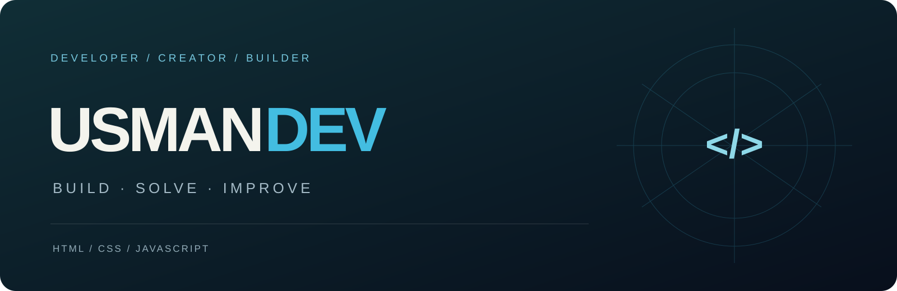

<h1 align="center">Hi, I’m Usman 👋</h1>

Developer working with HTML, CSS and JavaScript. Building useful web experiences and exploring desktop and Android applications.

<a href="https://malikusmandev.vercel.app">Portfolio</a> · <a href="https://github.com/MalikUsmanAbid?tab=repositories">Explore my repositories</a>

## Selected work

| Project | What it explores | Core technologies |
| --- | --- | --- |
| [Malik Oil Store](https://github.com/MalikUsmanAbid/malik-oil-store) | Storefront, server-verified checkout and staff operations | React, TypeScript, Firebase, Vercel |
| [SKV Construction](https://github.com/MalikUsmanAbid/SKV) | Construction website, shared content and quote requests | React, Vite, Supabase, Vercel |
| [CAM](https://github.com/MalikUsmanAbid/CAM) | Windows personal assistant with model choice and approval-gated project work | React, FastAPI, SQLite, Tauri |
| [Malik Oil](https://github.com/MalikUsmanAbid/Malik-Oil) | Android oilseed market workspace, history, research and local reports | Kotlin, Jetpack Compose, Material 3 |

Each project has a visual overview and its own setup instructions. CAM is a development preview; Android/device, cloud and live-service capabilities retain the verification boundaries documented in their repositories.

## My foundations

**HTML · CSS · JavaScript**

I care about thoughtful interfaces, clear documentation and small details that make software easier to use. This profile brings together my current work across web, desktop and mobile.

## Find me

- [Email](mailto:usmandev234@gmail.com)
- [WhatsApp: +92 315 7543808](https://wa.me/923157543808)
- [Facebook page](https://www.facebook.com/profile.php?id=61594398140960)
- [GitHub projects](https://github.com/MalikUsmanAbid?tab=repositories)
- [Personal portfolio](https://malikusmandev.vercel.app)

Build · Solve · Improve